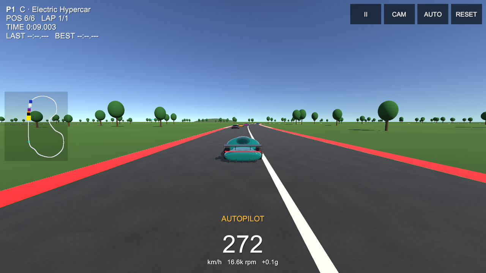

# 🏁 HYPERCAR-X Drive: Unity 3D Driving Simulator

[](https://jaineil32624.github.io/hypercar-x-drive-unity/play/)
[](https://jaineil32624.github.io/hypercar-x-drive-unity/downloads/HypercarX-Drive.apk)
[](https://play.unity.com/en/games/97c3a526-35bc-4ac6-bd0c-4ce596314c07/webgl-builds)
[](https://jaineil32624.github.io/hypercar-x-drive-unity/downloads/HypercarX-Drive-Windows.zip)

A 3D driving and racing game built in **Unity 6 (6000.3)** around the **HYPERCAR-X** electric hypercar. The car, its baked PBR textures and every physics number (mass, power, torque, grip, drag, downforce) come from the separate engineering project: [jaineil32624/hypercar-x](https://github.com/jaineil32624/hypercar-x).

Runs on **PC (Windows)**, **web browsers (WebGL)** and **Android phones**. Not VR.



## Game modes
| Mode | Players | What happens |
|---|---|---|
| **Race vs AI** | 1 | Up to 5 AI racers, 1/3/5 laps, positions, lap times, results |
| **Time Trial vs your ghost** | 1 | Your best lap is recorded and replayed as a see-through ghost. Beat it to save a new record and a new ghost |
| **Drag race ¼ mile** | 1 vs AI | Christmas-tree start lights, false-start detection, ET, trap speed and 0-60, compared with the engineering model's prediction |
| **Free roam** | 1 or 2 | Circuit, drag strip, skid pad, slalom and jump ramps; live 0-60 / 0-100 timer |
| **Split-screen race** | 2 (+ AI) | Two players on one PC or one phone, each with their own camera and HUD |
| **AI vs AI** | spectate | Watch the AI race, cycle cars and cameras |
| **Ghost duel** | spectate | Your two best saved laps race each other |
| **Autopilot** | any | Hand your car to the AI at any time (P key / AUTO button), and take it back |

Plus a **garage** (5 variants × swappable wheels, tyres, aero, motors, battery and brakes, each with pros and cons and live stats), 7 paint colours, a **local leaderboard** (best laps, race times, quarter-mile), and settings for laps, AI count and difficulty, touch/tilt controls, units, graphics and sound.

## Controls
| | Player 1 | Player 2 (split-screen) | Touch |
|---|---|---|---|
| Throttle / brake & reverse | W / S (arrows when playing solo) | ↑ / ↓ | GAS / BRAKE |
| Steer | A / D | ← / → | ◀ ▶ or tilt |
| Handbrake drift | Space | Right Shift | DRIFT |
| Camera (chase / far / bonnet / cinematic) | C | . | CAM |
| Autopilot | P | / | AUTO |
| Reset onto track | R | , | RESET |
| Pause | Esc | | II |

A gamepad also works for single-player steering and throttle.

## How the physics works
`CarController.cs` uses Unity WheelColliders with the engineering model's equations:
- **Tractive force** = min(T·G·η / r, P·η / v), split over four driven wheels, cut at the motor's 21,000 rpm limit
- **Grip**: tyre friction-curve stiffness = μ from the model (1.35 for the Electric Hypercar)
- **Aero**: drag ½ρv²C<sub>D</sub>A and downforce ½ρv²C<sub>L</sub>A applied as forces; the active rear wing flattens at speed and flips up as an air-brake
- **Suspension**: spring rate set for a 2.2 Hz ride frequency, 0.38 damping ratio, anti-roll bars, ABS
- **AI** (`AIDriver.cs`): follows the racing line with a speed-dependent look-ahead and brakes for corners using v = √(μ·g·R)·skill

## Project layout
```
Assets/
  HypercarX/Scripts/Runtime   CarController, AIDriver, GameManager, World, Ghost, ChaseCamera, VehicleSpec
  HypercarX/Scripts/Editor    ProjectBuilder: materials, scene, player settings, builds
  HypercarX/Textures          Baked PBR maps from Blender (paint, carbon, tyre, rim, disc)
  Resources/HypercarX.fbx     Car model exported from Blender
  Resources/variants.json     Five variants from the engineering model
docs/                         Website (GitHub Pages): WebGL build in /play, downloads, screenshots
```

## Build it yourself
1. Open the folder in **Unity 6000.3** (Hub ▸ Add project from disk).
2. Menu **HYPERCAR-X ▸ 1. Setup project**, then open `Assets/Scenes/Drive.unity` and press Play.
3. Builds: **HYPERCAR-X ▸ Build WebGL / Build Android APK / Build Windows**, or headless:
   ```
   Unity -batchmode -projectPath . -executeMethod HypercarX.EditorTools.ProjectBuilder.BuildAndroid
   ```

Self-test: run any build with `-hxautotest <folder>`. It plays every mode on autopilot, logs telemetry and saves screenshots.

---
Made by **Jaineil Rana**. Engineering model, Blender model and baked textures: [hypercar-x](https://github.com/jaineil32624/hypercar-x).
